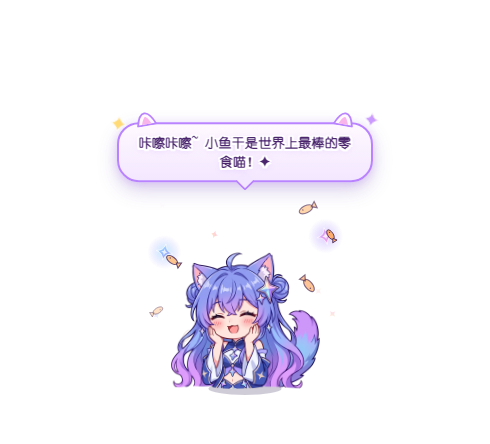

# Antigravity Gemini Pet

<p align="center">
  
</p>

<p align="center">
  <strong>Gemini Starlight Heterochromia Catgirl</strong> — a native desktop pet for <strong>Google Antigravity IDE</strong>.
</p>

<p align="center">
  <a href="./README_CN.md">简体中文</a> ·
  <a href="./LICENSE">MIT License</a>
</p>

---

## Features

- **17 pure-transparent multi-poses** — chibi + illustration cutouts, HiDPI alpha, no white boxes or jagged edges
- **Cat-ear sticker bubbles** — art-text speech bubbles with ear / star ornaments and soft pop-in motion
- **Window-edge snap** — drag near a screen edge and the pet docks with a gentle spring
- **Web Audio SFX** — zero-asset procedural meows, star chimes, and snack crunch sounds

Also included: IDE sidebar + frameless always-on-top desktop overlay, throw / bounce / multi-pet physics, and Antigravity Agent status sync.

---

## Install (recommended)

1. Download the latest `.vsix` from [Releases](https://github.com/baixiongwu0-bot/antigravity-gemini-pet/releases)
2. Open Antigravity IDE → **Extensions**
3. Drag the `.vsix` onto the Extensions panel (or use *Install from VSIX…*)
4. Reload the window — the pet appears in the Activity Bar and (optionally) as a desktop overlay

> Release installers are uploaded as GitHub Release assets only — they are **not** committed to git history.

---

## Build from source

```bash
npm install
npm run typecheck
npm run build
npm test
npm run package   # → dist/antigravity-gemini-pet-1.0.0.vsix
```

Then drag the generated `.vsix` into the Extensions panel, or:

```bash
antigravity-ide --install-extension dist/antigravity-gemini-pet-1.0.0.vsix --force
```

Requires a local Electron runtime for desktop overlay mode (`geminiPet.electronPath` or auto-detect). Electron binaries are never bundled.

---

## Quick tips

| Shortcut | Action |
| :--- | :--- |
| `Ctrl+Alt+P` / `Cmd+Alt+P` | Toggle desktop overlay |
| `Ctrl+Alt+Shift+P` / `Cmd+Alt+Shift+P` | Show / hide pet |
| `Ctrl+Alt+F` / `Cmd+Alt+F` | Feed dried fish |
| `Ctrl+Alt+Z` / `Cmd+Alt+Z` | Sleep / wake |

Left-click for reactions · drag & flick to throw · right-click the desktop pet for the control menu.

---

## License

[MIT](./LICENSE) · Inspired by [PC2005-cloud/dsh-pet](https://github.com/PC2005-cloud/dsh-pet)
