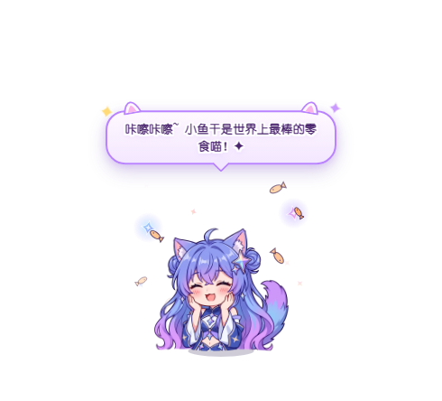

# Antigravity Gemini Pet

<p align="center">
  
</p>

<p align="center">
  <strong>Gemini 星芒异色瞳猫娘</strong> — 专属于 <strong>Google Antigravity IDE</strong> 的原生桌面宠物扩展。
</p>

<p align="center">
  <a href="./README.md">English</a> ·
  <a href="./LICENSE">MIT License</a>
</p>

---

## 核心特性

- **17 套纯透明多姿态** — Q 版 + 立绘抠图，HiDPI 透明通道，无白底、无锯齿框
- **猫耳贴纸艺术字气泡** — 带猫耳 / 星芒装饰的艺术字气泡，轻弹入场动效
- **窗口边缘吸附** — 拖到屏幕边缘自动轻弹吸附停靠
- **Web Audio 合成音效** — 零素材过程式喵呜、星芒风铃与小鱼干咔嚓声

另含：IDE 侧边栏内嵌 + 无边框置顶桌面悬浮、拖拽抛掷 / 反弹 / 多开互撞物理，以及 Antigravity Agent 状态联动。

---

## 安装（推荐）

1. 从 [Releases](https://github.com/antigravity-community/antigravity-gemini-pet/releases) 下载最新 `.vsix`
2. 打开 Antigravity IDE → **扩展**面板
3. 将 `.vsix` **拖入扩展面板**（或选「从 VSIX 安装…」）
4. 重载窗口即可——活动栏出现猫娘控制台，并可自动唤起桌面悬浮窗

> Release 安装包仅作为 GitHub Release 附件上传，**不会**进入 Git 历史。

---

## 源码构建

```bash
npm install
npm run typecheck
npm run build
npm test
npm run package   # → dist/antigravity-gemini-pet-1.0.0.vsix
```

将生成的 `.vsix` 拖入扩展面板，或：

```bash
antigravity-ide --install-extension dist/antigravity-gemini-pet-1.0.0.vsix --force
```

桌面悬浮模式需要本机 Electron（`geminiPet.electronPath` 或自动探测）。仓库与安装包均不捆绑 Electron 二进制。

---

## 快捷操作

| 快捷键 | 功能 |
| :--- | :--- |
| `Ctrl+Alt+P` / `Cmd+Alt+P` | 切换桌面悬浮 |
| `Ctrl+Alt+Shift+P` / `Cmd+Alt+Shift+P` | 显隐猫娘 |
| `Ctrl+Alt+F` / `Cmd+Alt+F` | 喂小鱼干 |
| `Ctrl+Alt+Z` / `Cmd+Alt+Z` | 打盹 / 叫醒 |

左键互动 · 拖拽抛掷 · 右键桌面猫娘打开控制菜单。

---

## 开源协议

[MIT](./LICENSE) · Inspired by [PC2005-cloud/dsh-pet](https://github.com/PC2005-cloud/dsh-pet)
